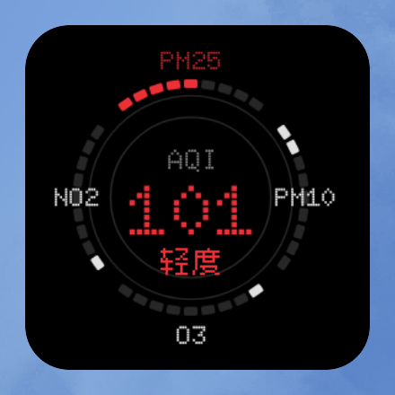
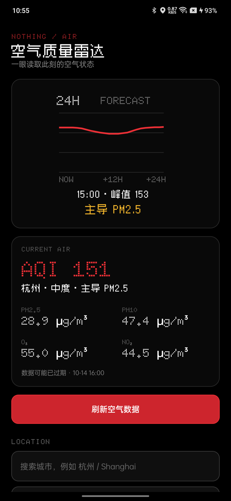

# 空气质量雷达

Nothing 点阵风格的原生 Android 1×1 桌面组件。首页以一个四段式空气环显示 PM2.5、PM10、O₃ 与 NO₂：每段点亮数量使用对应污染物的专项 US AQI，主导污染物使用 Nothing 红强调；圆心只保留大号 AQI 与空气等级。第二页显示未来24小时 US AQI 模型趋势、峰值时段与主导污染物。





- 数据：Open-Meteo Air Quality API / CAMS 模型，无 API Token。
- 明确显示 `US AQI · MODEL`，不将模型结果冒充中国官方 AQI 或地面监测站实测。
- 每个组件实例独立保存城市、缓存和页码。
- Android 官方组件周期、联网周期任务与轻量闹钟组成约30分钟自动刷新兜底；省电模式下可能由系统延后。
- 刷新与切页播放约1.5秒分段充能或趋势扫描，静止后停止高频更新。
- 详情页提供大号 AQI、四项真实浓度、模型时间、城市搜索和手动刷新。
- Doto 用于英文和数字，Zpix 用于中文；纯黑底、14dp 圆角及 3×5 对齐遵循本工作区组件规范。

## 构建

```sh
sh build.sh
adb install -r build/air-radar.apk
```

安装后打开“空气质量雷达”选择城市，再手动添加1×1组件。主体点击打开详情页，右侧48dp热区切换空气环和24小时趋势页。

权限仅包含联网、网络状态和开机恢复任务。数据来源：https://open-meteo.com/en/docs/air-quality-api
